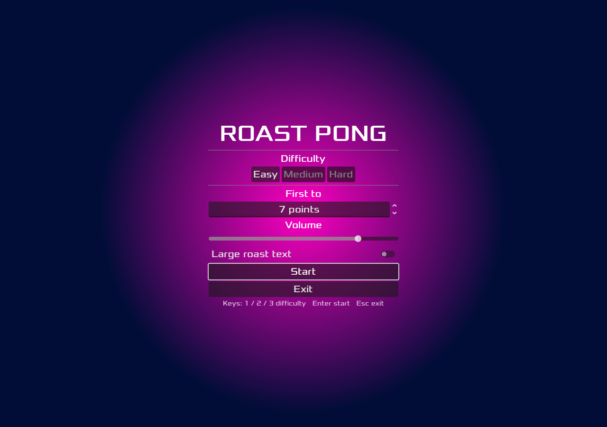
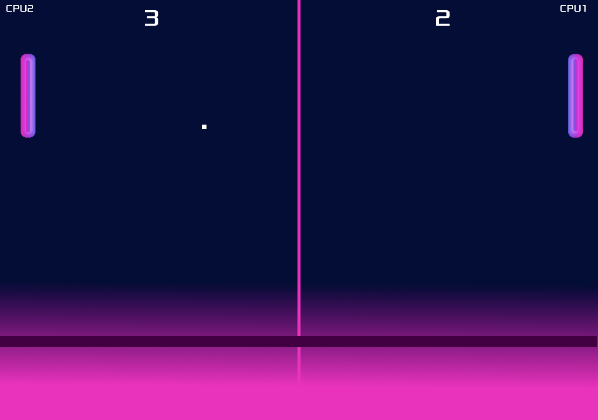
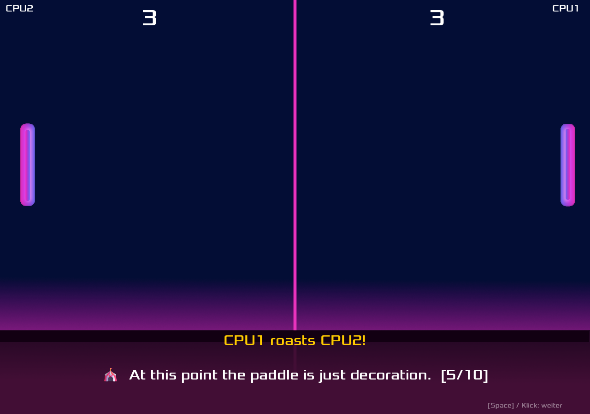
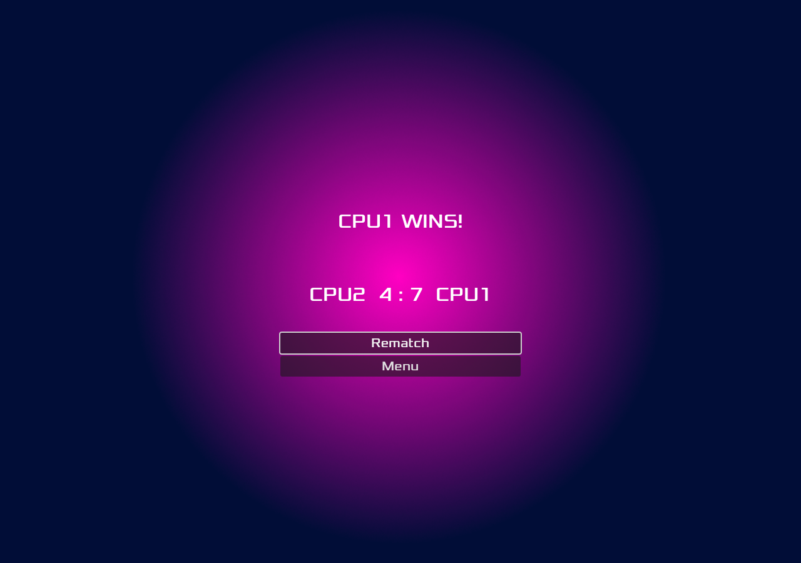

# Roast Pong


[](LICENSE)


**DE:** Pong, bei dem zwei CPU-Paddles gegeneinander spielen. Wer einen Punkt verliert, wird vom Gegner geroastet und kontert – die Sprüche kommen live von der Google Gemini API, offline aus einer lokalen Liste.
**EN:** Pong where two CPU paddles play each other. The player who loses a point gets roasted and claps back – lines come live from the Google Gemini API, or from a local list when offline.

## Screenshots

| Menü / Menu | Spiel / Gameplay |
|---|---|
|  |  |
| **Roast nach einem Punkt / Roast after a point** | **Game over** |
|  |  |

## Features

- CPU gegen CPU, drei Schwierigkeitsgrade und Punktelimit (1–21) / three difficulties and a score limit (1–21)
- Roast nach jedem Punkt plus Konter des Verlierers, jeweils mit Bewertung 1–10 / a roast after every point plus a counter, each rated 1–10
- Fallback auf lokale Roasts ohne API-Key oder Verbindung / local fallback without API key or connection
- Pausemenü, 3-2-1-Countdown, Lautstärke, große Roast-Schrift; Einstellungen werden gespeichert / pause menu, countdown, volume, large roast text; settings are saved

## Voraussetzungen / Requirements

- [Godot](https://godotengine.org/download) 4.x (das Projekt wurde mit 4.7 erstellt / created with 4.7)
- Optional: [Gemini API-Key](https://aistudio.google.com)

## Installation

```bash
git clone https://github.com/TranceMeli/RoastPong.git
cd RoastPong
```

Optional, für KI-Roasts / optional, for AI roasts: Vorlage kopieren und Key eintragen / copy the template and add your key:

```bash
cp scripts/Config.gd.example scripts/Config.gd
```

`scripts/Config.gd` steht in `.gitignore` und wird nicht committet. Ohne Key (leerer Wert) werden lokale Roasts genutzt.

## Schnellstart / Quick start

Projekt in Godot öffnen und **F5** drücken, oder per Kommandozeile / open the project in Godot and press **F5**, or from the command line:

```bash
godot --path .
```

## Steuerung / Controls

| Taste / Key | Wirkung / Effect |
|---|---|
| `1` `2` `3` | Schwierigkeit im Menü / difficulty in the menu |
| `Enter` | Start (Menü) / start (menu) |
| `Space`, Klick / click | Roast überspringen / skip roast |
| `P`, `Esc` | Pause an/aus / toggle pause |
| `Esc` (Menü / menu) | Beenden / quit |

## Konfiguration / Configuration

| Option | Beschreibung / Description | Standard / Default |
|---|---|---|
| `GEMINI_KEY` in `scripts/Config.gd` | Gemini API-Key | leer / empty (lokale Roasts) |
| Menü: Difficulty | `easy`, `medium`, `hard` | `medium` |
| Menü: First to | Punktelimit / score limit | 7 |
| Menü: Volume | Gesamtlautstärke / master volume | 80 % |
| Menü: Large roast text | Größere Roast-Schrift / larger roast font | aus / off |

Gespeichert wird in `user://settings.cfg`. Das Modell wird in `scripts/roast_overlay.gd` (`GEMINI_URL`) festgelegt.

## Wie die Roasts entstehen / How roasts work

Gemini antwortet als JSON / Gemini answers as JSON:

```json
{ "roast": "Even my grandma paddles faster.", "score": 9, "emoji": "😱" }
```

Bei Fehler, Timeout (6 s) oder fehlendem Key wählt `RoastScorer` einen Spruch aus `roasts.gd` – kurze, harte Sprüche werden bevorzugt.

## Projektstruktur / Project structure

| Pfad / Path | Inhalt / Content |
|---|---|
| `scenes/` | Menü, Spiel, Roast-Overlay, Game Over |
| `scripts/main.gd` | Spielablauf: Punkte, Countdown, Pause |
| `scripts/ball.gd`, `cpu.gd` | Ball und Paddle-KI |
| `scripts/roast_overlay.gd` | Gemini-Anfrage und Anzeige |
| `scripts/game_settings.gd` | Autoload: Einstellungen und Speichern |
| `scripts/roasts.gd`, `roast_scorer.gd` | Autoloads: lokale Roasts und Bewertung |
| `assets/` | Schrift, Grafiken, Sounds |

## Entwicklung / Development

Es gibt noch keine automatisierten Tests. Prüfen, dass das Projekt fehlerfrei lädt / there are no automated tests yet. Check that the project loads without errors:

```bash
godot --headless --path . --quit-after 120
```

## Support

Fehler und Fragen / bugs and questions: [GitHub Issues](https://github.com/TranceMeli/RoastPong/issues)

## Lizenz / License

[MIT](LICENSE)
